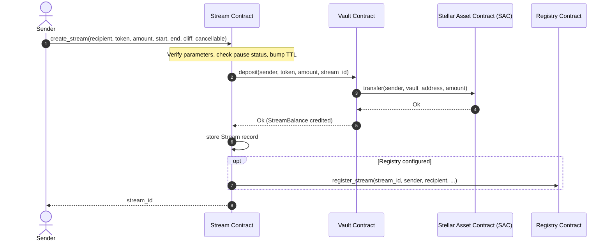
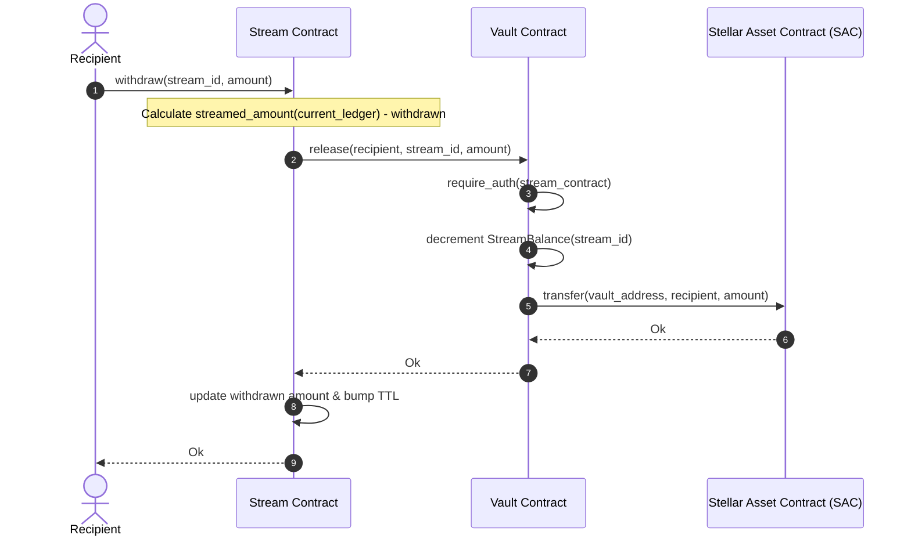
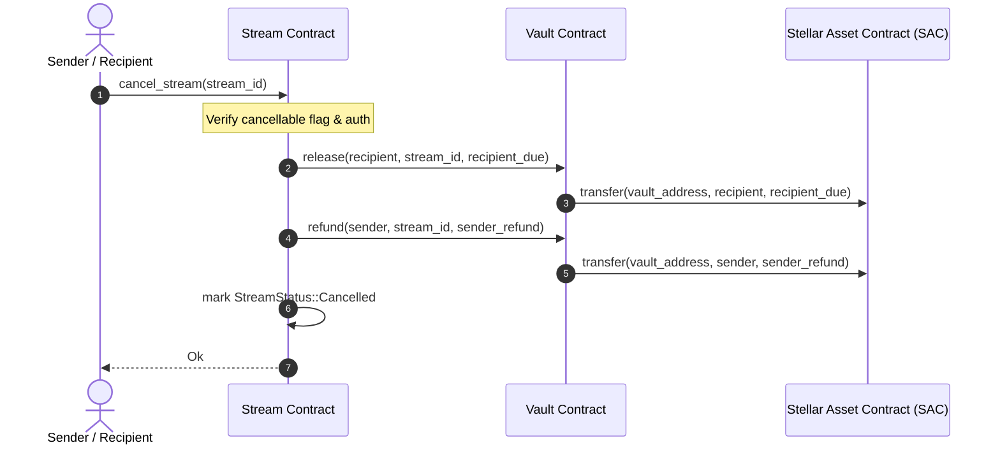

# Architecture Overview: Contract Interactions

This document explains how the three Stellar Stream Hive smart contracts (`Stream`, `Vault`, and `Registry`) interact across key protocol workflows.

```
       +------------------------------------+
       |          Client / Frontend         |
       +-----------------+------------------+
                         |
           create_stream | withdraw / cancel
                         v
                +-----------------+
                | Stream Contract |
                +--------+--------+
                         |
      authorize_and_pay  |  release / refund
                         v
                 +---------------+
                 | Vault Contract|
                 +-------+-------+
                         |
             transfer SAC|
                         v
               +-------------------+
               | Token SAC Contract|
               +-------------------+
```

---

## 1. Stream Creation & Escrow Deposit

When a sender creates a stream, tokens are pulled into the Vault before state is committed in the Stream contract.



---

## 2. Accrued Token Withdrawal

The recipient claims tokens accrued up to the current ledger sequence.



---

## 3. Stream Cancellation & Fund Distribution

If a cancellable stream is cancelled, accrued funds are sent to the recipient and remainder is refunded to the sender.


