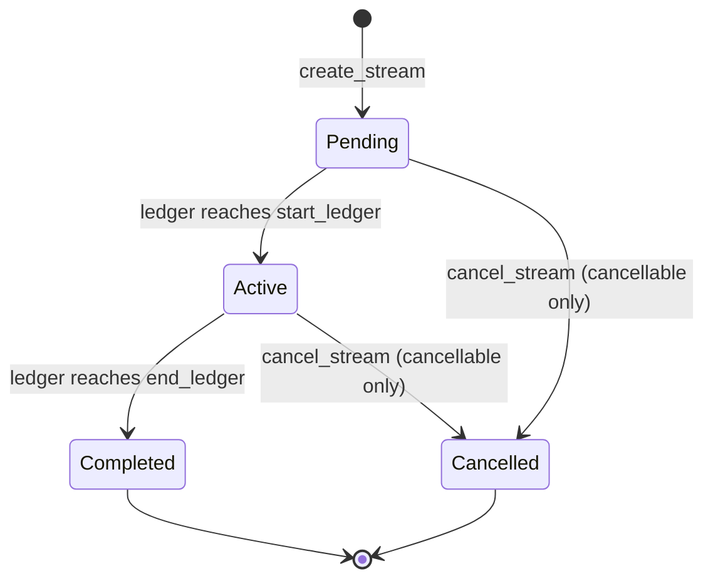

# Stream Contract

`contracts/stream` — crate name `stellar-stream-hive-stream`.

## Overview

The stream contract is the heart of Stellar Stream Hive. It lets a
`sender` commit `total_amount` of a token to a `recipient`, streamed
linearly, ledger by ledger, between `start_ledger` and `end_ledger`. At any
point after an optional `cliff_ledger`, the recipient can withdraw
whatever has accrued and not yet been withdrawn.

The stream contract never holds funds itself. On `create_stream` it
instructs the [vault contract](./vault.md) to pull the deposit; on
`withdraw`/`cancel_stream` it instructs the vault to pay out. This
contract is purely the bookkeeping and math layer.

## The streaming formula

```text
elapsed        = min(current_ledger, end_ledger) - start_ledger   (clamped to 0 before start)
total_duration = end_ledger - start_ledger
streamed       = total_amount * elapsed / total_duration
withdrawable   = max(streamed - withdrawn, 0)                     (0 before cliff_ledger)
```

Implemented in `contracts/stream/src/math.rs` as pure, `Env`-independent
functions so the arithmetic can be exhaustively unit tested in isolation
from contract/storage concerns.

Every step uses `i128` checked arithmetic (`checked_mul`, `checked_div`,
`checked_add`, `checked_sub`) — never raw operators, never `unwrap()` on a
computation that could realistically overflow. The multiplication
(`total_amount * elapsed`) always happens **before** the division (`/
total_duration`), which avoids the precision loss that `(total_amount /
total_duration) * elapsed` would introduce for any amount that doesn't
divide evenly.

### Worked example

A payroll stream of `90,000` USDC (6 decimals, but we'll use whole units
for clarity) running for a 30-day pay period, ledgers `1,000` through
`519,000` (30 days at 5s ledgers ≈ 518,400 ledgers — rounded here for
readability), no cliff:

- At ledger `1,000` (the start): `elapsed = 0` → `streamed = 0`.
- Halfway through, ledger `260,000`: `elapsed = 259,000`,
  `total_duration = 518,000`, `streamed = 90,000 * 259,000 / 518,000 =
  44,990` (not exactly half due to integer rounding — this is expected and
  the whole reason we use `checked_div`, which always rounds down, never
  up: the recipient is never able to withdraw more than has truly accrued).
- At or after ledger `519,000`: `streamed = 90,000` (the clamp via
  `min(current_ledger, end_ledger)` caps `elapsed` at `total_duration`).

If the recipient withdraws `20,000` at the halfway point, `withdrawn`
becomes `20,000`, and `withdrawable_amount` at that same instant becomes
`44,990 - 20,000 = 24,990`.

### Cancellation freezing

If the sender cancels at ledger `260,000`, the contract:

1. Computes `streamed_now = 44,990` (as above) using the real current
   ledger — this is the last moment `streamed_amount` is computed against
   live time.
2. Refunds `total_amount - streamed_now = 45,010` back to the sender
   immediately via the vault.
3. Marks the stream `Cancelled` and records `cancelled_at_ledger =
   260,000`.

From that point on, `streamed_amount` for this stream ignores the real
ledger entirely and always recomputes the formula using
`cancelled_at_ledger` in place of "now." This freezes the streamed value
at `44,990` forever — the recipient can still withdraw up to that amount
(minus whatever they'd already withdrawn), but ledger progress after
cancellation can never inflate it further.

**Cancelling before the cliff.** The recipient earns nothing before
`cliff_ledger`, so a stream cancelled earlier is frozen at `0`: the sender is
refunded the entire deposit, the `cancel` event reports `streamed_now = 0`, and
nothing is left in the vault. (Earlier revisions refunded only the unstreamed
remainder while leaving the accrued part unwithdrawable, which stranded it.)

## Data model

```rust
pub enum StreamStatus { Pending, Active, Completed, Cancelled }

pub struct Stream {
    pub id: u64,
    pub sender: Address,
    pub recipient: Address,
    pub token: Address,
    pub total_amount: i128,
    pub withdrawn: i128,
    pub start_ledger: u32,
    pub end_ledger: u32,
    pub cliff_ledger: u32,
    pub cancellable: bool,
    pub status: StreamStatus,
    pub created_at: u32,
    pub cancelled_at_ledger: u32, // 0 unless cancelled
}
```

`Pending`, `Active`, and `Completed` are **derived**, not stored — they are
purely a function of the current ledger versus `start_ledger`/
`end_ledger` (see `math::compute_status`). `Cancelled` is the one status
that genuinely needs to be persisted, since it can't be reconstructed from
time alone. `get_stream`, `get_status`, and the `get_streams_by_*`
functions all recompute the live status on every read.

### Status lifecycle



`Pending`, `Active` and `Completed` follow the ledger and are never written to
storage. `Cancelled` is persisted by `cancel_stream`. A stream that has
`Completed` can no longer be cancelled (`AlreadyFinalized`).

## Function reference

### `initialize(env, admin, vault)`
One-time setup, requires `admin.require_auth()`.

### `create_stream(env, sender, recipient, token, total_amount, start_ledger, end_ledger, cliff_ledger, cancellable) -> u64`
Requires `sender.require_auth()`. Validates `total_amount > 0`,
`end_ledger > start_ledger`, and `start_ledger <= cliff_ledger <=
end_ledger`. Deposits `total_amount` into the vault, stores the new
`Stream`, indexes it under both sender and recipient, and returns its id.
Emits a `create` event.

### `streamed_amount(env, stream_id) -> i128`
Read-only. See [formula](#the-streaming-formula) above.

### `withdrawable_amount(env, stream_id) -> i128`
Read-only. `streamed_amount - withdrawn`, floored at 0, and forced to 0
before `cliff_ledger`.

### `withdraw(env, recipient, stream_id, amount)`
Requires `recipient.require_auth()` and that the caller is the stream's
recipient. Rejects `amount` greater than `withdrawable_amount`
(`ExceedsWithdrawable`). Instructs the vault to `release` the funds.
Emits a `withdraw` event.

### `withdraw_max(env, recipient, stream_id) -> i128`
Convenience wrapper around `withdraw` that pulls the entire currently
withdrawable balance and returns the amount withdrawn (0 if nothing was
available — this is not an error).

### `cancel_stream(env, sender, stream_id)`
Requires `sender.require_auth()` and that the caller is the stream's
sender. Fails with `NotCancellable` if the stream was created with
`cancellable = false`, and `AlreadyFinalized` if the stream is already
`Cancelled` or `Completed`. Freezes the streamed amount (see
[Cancellation freezing](#cancellation-freezing)), refunds the unstreamed
remainder to the sender via the vault, and emits a `cancel` event.

### `get_stream(env, stream_id) -> Stream`
Read-only, with `status` recomputed live.

### `get_streams_by_sender(env, sender) -> Vec<Stream>` / `get_streams_by_recipient(env, recipient) -> Vec<Stream>`
Read-only, indexed lookups.

### `count_streams_by_sender(env, sender) -> u32` / `count_streams_by_recipient(env, recipient) -> u32`
Read-only. Number of streams ever created for that party.

### `get_streams_by_sender_page(env, sender, offset, limit) -> Vec<Stream>` / `get_streams_by_recipient_page(env, recipient, offset, limit) -> Vec<Stream>`
Read-only, creation-ordered pages. `limit` is capped at `MAX_PAGE_SIZE`
(50) so a single call can never be forced to hydrate an unbounded number of
streams; an `offset` past the end returns an empty vec. Prefer these over
`get_streams_by_*` for any address that may accumulate many streams.

### `get_status(env, stream_id) -> StreamStatus`
Read-only, live-computed status.

### `pause(env)` / `unpause(env)` / `is_paused(env) -> bool`
`pause` and `unpause` require the admin's authorization. While paused,
`create_stream` fails with `Paused`. **Pausing never blocks `withdraw`,
`withdraw_max` or `cancel_stream`** -- it is an emergency brake on new
deposits, not a way to trap funds that are already streaming.

### `get_admin(env) -> Address`
Read-only. Returns the current admin address. No authorization required.
Fails with `NotInitialized` if `initialize` has not been called.

### `get_vault(env) -> Address`
Read-only. Returns the vault contract address set during `initialize`. No
authorization required. Fails with `NotInitialized` if `initialize` has not
been called.

### `transfer_admin(env, new_admin)`
Requires authorization from **both** the current admin and `new_admin`, so
the role cannot be handed to an address nobody controls by mistake.

## Roles and permissions

Who may call each function, and what the contract checks before acting. The
"Enforced in code" column is taken from the `require_auth()` calls and identity
checks in `contracts/stream/src/lib.rs`.

| Function | Callable by | Enforced in code |
|---|---|---|
| [`initialize`](#initializeenv-admin-vault) | Admin, once | `admin.require_auth()`; a second call fails with `AlreadyInitialized` |
| [`create_stream`](#create_streamenv-sender-recipient-token-total_amount-start_ledger-end_ledger-cliff_ledger-cancellable---u64) | Sender | `sender.require_auth()`; fails with `Paused` while paused |
| [`withdraw`](#withdrawenv-recipient-stream_id-amount) | Recipient of the stream | `recipient.require_auth()`; `recipient` must equal the stream's `recipient` (`Unauthorized`) |
| [`withdraw_max`](#withdraw_maxenv-recipient-stream_id---i128) | Recipient of the stream | `recipient` must equal the stream's `recipient` (`Unauthorized`); authorization comes from the delegated `withdraw` call |
| [`cancel_stream`](#cancel_streamenv-sender-stream_id) | Sender of the stream | `sender.require_auth()`; `sender` must equal the stream's `sender` (`Unauthorized`) |
| [`pause`](#pauseenv--unpauseenv--is_pausedenv---bool) / `unpause` | Admin | `admin.require_auth()` against the stored admin |
| [`transfer_admin`](#transfer_adminenv-new_admin) | Current admin and the new admin | `require_auth()` on both addresses |
| [`streamed_amount`](#streamed_amountenv-stream_id---i128), [`withdrawable_amount`](#withdrawable_amountenv-stream_id---i128), [`get_stream`](#get_streamenv-stream_id---stream), [`get_status`](#get_statusenv-stream_id---streamstatus), [`get_streams_by_sender`](#get_streams_by_senderenv-sender---vecstream--get_streams_by_recipientenv-recipient---vecstream), [`count_streams_by_sender`](#count_streams_by_senderenv-sender---u32--count_streams_by_recipientenv-recipient---u32), [`get_streams_by_sender_page`](#get_streams_by_sender_pageenv-sender-offset-limit---vecstream--get_streams_by_recipient_pageenv-recipient-offset-limit---vecstream), `is_paused`, `get_admin`, `get_vault` | Anyone | Read-only; no authorization |

## Events

| Topic | Payload | Emitted when |
|---|---|---|
| `("create", stream_id)` | `(sender, recipient, token, total_amount, start_ledger, end_ledger, cliff_ledger, cancellable)` | `create_stream` succeeds |
| `("withdraw", stream_id)` | `(recipient, amount)` | `withdraw` (or `withdraw_max`) succeeds |
| `("cancel", stream_id)` | `(sender, streamed_now, remainder)` | `cancel_stream` succeeds |
| `("pause")` | `(admin)` | `pause` succeeds |
| `("unpause")` | `(admin)` | `unpause` succeeds |
| `("admin_transfer")` | `(previous_admin, new_admin)` | `transfer_admin` succeeds |

The `create` event carries every field an off-chain indexer needs to
reconstruct the stream (including `cliff_ledger` and `cancellable`), so
[the API](https://github.com/Stellar-Hive/stellar-stream-hive-api) never has
to make a follow-up contract read per stream.

## Cross-contract calls to the vault

The stream contract calls the vault purely via `Env::invoke_contract` by
address and function-name symbol (see `contracts/stream/src/vault_client.rs`),
rather than depending on the vault crate as a Rust library dependency.
This keeps the two contracts fully decoupled at compile time — no fixed
build order, no WASM-artifact dependency between crates — while producing
exactly the same on-chain call as a generated `Client` would.

The stream crate's tests do not depend on the vault crate. Instead,
`contracts/stream/src/test.rs` defines an in-file `MockVault` — a minimal
stand-in registered as a contract in the test `Env` — so the stream
contract's full create → deposit → withdraw → release → cancel → refund
flow is exercised through real cross-contract invocation, without a Rust
dependency on the vault crate. The real vault's security boundary
(including the caller check that only the configured stream contract may
call it) and its balance accounting are covered by the vault crate's own
tests in `contracts/vault/src/test.rs`. Note that the mock deliberately
does **not** enforce that caller check, so it must not be relied on to
validate vault-side authorization.

## Errors

| Code | Name | Meaning |
|---|---|---|
| 1 | `AlreadyInitialized` | `initialize` called twice |
| 2 | `NotInitialized` | called before `initialize` |
| 3 | `Unauthorized` | caller is not the stream's sender/recipient |
| 4 | `InvalidAmount` | amount was zero or negative |
| 5 | `InvalidTimeRange` | `end_ledger <= start_ledger` |
| 6 | `InvalidCliff` | cliff outside `[start_ledger, end_ledger]` |
| 7 | `StreamNotFound` | no stream with that id |
| 8 | `BeforeCliff` | reserved, currently unused (a withdrawal before the cliff returns `ExceedsWithdrawable`) |
| 9 | `ExceedsWithdrawable` | amount above `withdrawable_amount` |
| 10 | `NotCancellable` | stream created with `cancellable = false` |
| 11 | `AlreadyFinalized` | stream already cancelled or completed |
| 12 | `MathOverflow` | checked arithmetic overflowed |
| 13 | `Paused` | `create_stream` while the contract is paused |

## Security notes

- Every state-changing function that acts on behalf of a specific party
  calls `require_auth()` on that party's address before doing anything
  else: `sender` for `create_stream`/`cancel_stream`, `recipient` for
  `withdraw`/`withdraw_max`, `admin` for `initialize`.
- The contract additionally checks that the authenticated address matches
  the stream's recorded `sender`/`recipient` — `require_auth()` alone only
  proves identity, not authorization for a specific stream.
- `pause` can only stop *new* streams; existing recipients can always
  withdraw and existing senders can always cancel (covered by
  `test_pause_never_traps_existing_streams`).
- All balance arithmetic uses checked i128 operations; overflow/underflow
  returns `StreamError::MathOverflow` instead of panicking or wrapping.
- The contract can never cause the vault to pay out more than a stream's
  deposited balance, because `withdrawable_amount` is bounded by
  `streamed_amount <= total_amount`, and `total_amount` is exactly what
  was deposited on creation.
